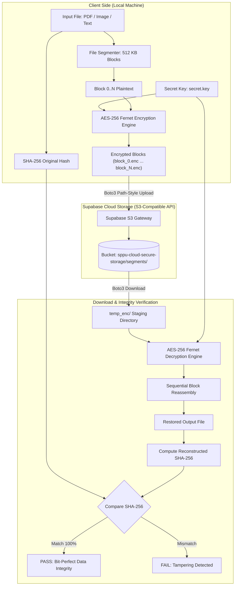

# SPPU Cloud Computing Laboratory Mini-Project
## Group C (Option 2): Secure Cloud Storage with File Segmentation, AES-256 Encryption & Supabase S3 Integration

[](https://www.python.org/)
[](https://supabase.com/docs/guides/storage/s3/authentication)
[](https://cryptography.io/en/latest/fernet/)
[](https://csrc.nist.gov/publications/detail/fips/180/4/final)

---

## 1. Project Overview & Academic Objectives

In multi-tenant cloud storage architectures, uploading raw data files introduces severe confidentiality, compliance, and multi-tenancy leakage risks. This laboratory project implements a client-side **Zero-Knowledge Cloud Storage Architecture**:

1. **File Segmentation**: Arbitrary user files (PDFs, binary datasets, high-res images, text) are chunked into configurable blocks (default: **512 KB**).
2. **Block-Level AES-256 Encryption**: Every segment is independently encrypted on the client side before transmission using the `cryptography.fernet` engine (AES-128-CBC with HMAC-SHA256 authentication derived from a 256-bit master key).
3. **Supabase Storage S3-Compatible Integration**: Encrypted blocks are directly uploaded to an S3 bucket in Supabase Storage using `boto3`. Crucially, requests use **Path-Style Addressing** (`botocore.client.Config(s3={"addressing_style": "path"})`) as required by Supabase's S3 gateway.
4. **Encrypted Download & Bit-Perfect Reconstruction**: Encrypted blocks are retrieved into a local staging directory (`temp_enc/`), decrypted using the master key, and stitched into the restored file.
5. **Cryptographic Integrity Audit**: A 256-bit SHA-256 hash is computed on the reassembled file and matched against the original file's hash to programmatically certify 100% bit-level data integrity.

---

## 2. Architecture & Data Flow



---

## 3. Directory Structure

```
h:/CC/
├── .env                       # Active environment configuration
├── .env.example               # Template for Supabase S3 credentials
├── requirements.txt           # Project dependencies
├── secret.key                 # Generated 256-bit symmetric encryption key
├── secure_storage.py          # Core engine (Crypto, S3 Client, Segmentation, Reassembly)
├── main.py                    # CLI application (upload & download commands)
├── demo.py                    # Self-contained automated test & demonstration script
├── mock_cloud_storage/        # Local mock storage folder (auto-fallback if offline)
└── README.md                  # Complete documentation and viva guide
```

---

## 4. Setup & Configuration

### Step 1: Install Dependencies
```bash
python -m pip install -r requirements.txt
```

### Step 2: Supabase S3 Credentials Configuration
1. Log into your [Supabase Dashboard](https://supabase.com/dashboard).
2. Navigate to **Project Settings** -> **Storage** -> **S3 Access Keys**.
3. Click **Generate new S3 Access Key** and copy:
   - `Access Key ID`
   - `Secret Access Key`
   - `Endpoint URL` (e.g. `https://<your-project-ref>.storage.supabase.co/storage/v1/s3`)
4. Create a bucket in Supabase Storage named `sppu-cloud-secure-storage` (or your preferred name).
5. Open `.env` and configure:
```env
AWS_ACCESS_KEY_ID=your_supabase_s3_access_key_id
AWS_SECRET_ACCESS_KEY=your_supabase_s3_secret_key
AWS_DEFAULT_REGION=ap-south-1
S3_BUCKET_NAME=sppu-cloud-secure-storage
SUPABASE_S3_ENDPOINT=https://<your-project-ref>.storage.supabase.co/storage/v1/s3
STORAGE_MODE=supabase
CHUNK_SIZE_BYTES=524288
```

> **Note on Offline Demonstration**: If running in an environment without internet access or prior to setting up Supabase keys, the system automatically falls back to `./mock_cloud_storage/` with an informative console notice, allowing uninterrupted viva demonstration.

---

## 5. Command-Line Interface (CLI) Usage

### 1. Upload File (Segmentation, Encryption & Cloud Upload)
```bash
python main.py upload <file_path> [--chunk-size 524288] [--key-file secret.key]
```
**Example:**
```bash
python main.py upload sample_report.pdf
```
**Console Output:**
```text
========================================================================
   SAVITRIBAI PHULE PUNE UNIVERSITY (SPPU)
   Department of Computer Engineering - Cloud Computing Laboratory
   Mini-Project: File Segmentation, AES-256 & Supabase S3 Integration
========================================================================
Starting Upload Pipeline for: 'sample_report.pdf'
Storage Mode: Supabase S3 Cloud
Target Bucket: 'sppu-cloud-secure-storage'

[KEY] Using AES-256 encryption key from: 'secret.key'
[SEGMENT] Splitting 'sample_report.pdf' (1,245,184 bytes) into 524,288 byte blocks...
  -> Uploaded Block 0: 524,288 B plaintext -> 699,148 B ciphertext -> Key: 'segments/block_0.enc'
  -> Uploaded Block 1: 524,288 B plaintext -> 699,148 B ciphertext -> Key: 'segments/block_1.enc'
  -> Uploaded Block 2: 196,608 B plaintext -> 262,244 B ciphertext -> Key: 'segments/block_2.enc'
[MANIFEST] Uploaded metadata manifest with SHA-256: 4a2b8e...

To download and reconstruct this file, run:
python main.py download 3 ./restored_sample_report.pdf 4a2b8e4e976f9d2...
```

---

### 2. Download File (Retrieval, Decryption & Bit-Perfect Audit)
```bash
python main.py download <total_blocks> <output_file_path> <expected_hash> [--key-file secret.key]
```
**Example:**
```bash
python main.py download 3 ./restored_sample_report.pdf 4a2b8e4e976f9d2...
```
**Console Output:**
```text
========================================================================
   SAVITRIBAI PHULE PUNE UNIVERSITY (SPPU)
   Mini-Project: File Segmentation, AES-256 & Supabase S3 Integration
========================================================================
Starting Download & Reassembly Pipeline
Retrieving 3 blocks from 'sppu-cloud-secure-storage' into target: './restored_sample_report.pdf'

[KEY] Loaded AES-256 key from: 'secret.key'
[DOWNLOAD] Retrieving 3 encrypted blocks from Supabase Storage into 'temp_enc/'...
  -> Decrypted Block 0: 699,148 B ciphertext -> 524,288 B plaintext (Verified Authenticated Tag)
  -> Decrypted Block 1: 699,148 B ciphertext -> 524,288 B plaintext (Verified Authenticated Tag)
  -> Decrypted Block 2: 262,244 B ciphertext -> 196,608 B plaintext (Verified Authenticated Tag)
[AUDIT] Expected Hash:      4a2b8e4e976f9d2...
[AUDIT] Reconstructed Hash: 4a2b8e4e976f9d2...
[STATUS] [PASS] 100% BIT-PERFECT RECONSTRUCTION CONFIRMED!
```

---

### 3. Automated End-to-End Demonstration Script
To demonstrate all features (Text, PNG Image, PDF, and Tamper Resistance Test) in one command:
```bash
python demo.py
```

---

## 6. Key Technical Explanations for External Viva

### Q1: Why is `botocore.client.Config(s3={"addressing_style": "path"})` required for Supabase?
> **Answer**: Standard AWS S3 uses virtual-host addressing by default: `https://<bucket-name>.s3.amazonaws.com/<key>`. However, Supabase Storage does not use dynamic bucket-level DNS routing. It expects requests in path-style format: `https://<project-ref>.storage.supabase.co/storage/v1/s3/<bucket-name>/<key>`. Without configuring `addressing_style: "path"`, DNS lookups fail.

### Q2: What cryptographic guarantees does `cryptography.fernet` provide?
> **Answer**: Fernet uses AES in **CBC mode with 128-bit key** and an **HMAC-SHA256 signature** derived from a 256-bit master key. It uses PKCS7 padding and a unique 128-bit Initialization Vector (IV) for every encrypted block. Crucially, it provides **Authenticated Encryption**: if an adversary modifies even a single bit in an encrypted block in cloud storage, decryption raises an `InvalidToken` exception and rejects the block before it can compromise memory or disk.

### Q3: Why chunk files into 512 KB blocks instead of encrypting as a single monolith?
> **Answer**: 
> 1. **Fault Tolerance & Parallelism**: If transmission of a 100 MB file fails at 98%, only the affected 512 KB block needs retransmission rather than restarting the entire file.
> 2. **Memory Efficiency**: Streaming files block-by-block allows arbitrarily large files (e.g. 5 GB video or medical imagery) to be processed with minimal constant memory footprint.
> 3. **Access Control & Deduplication**: Individual blocks can be cached, audited, or shared independently.

### Q4: How is 100% bit-level data integrity guaranteed?
> **Answer**: Pre-upload, the application computes the SHA-256 hash of the complete original file stream. During download, all decrypted segments are appended in exact sequential order, and the SHA-256 checksum is recalculated on the restored file. Matching 256-bit hashes mathematically guarantees that not a single bit was corrupted, reordered, or dropped.
